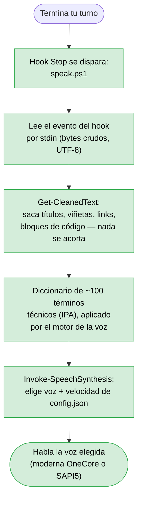
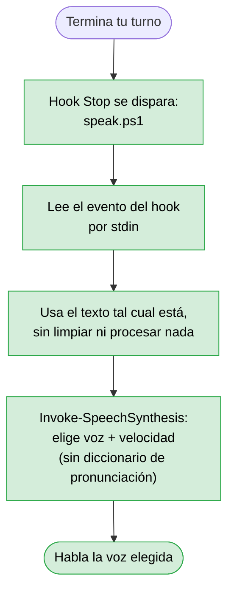
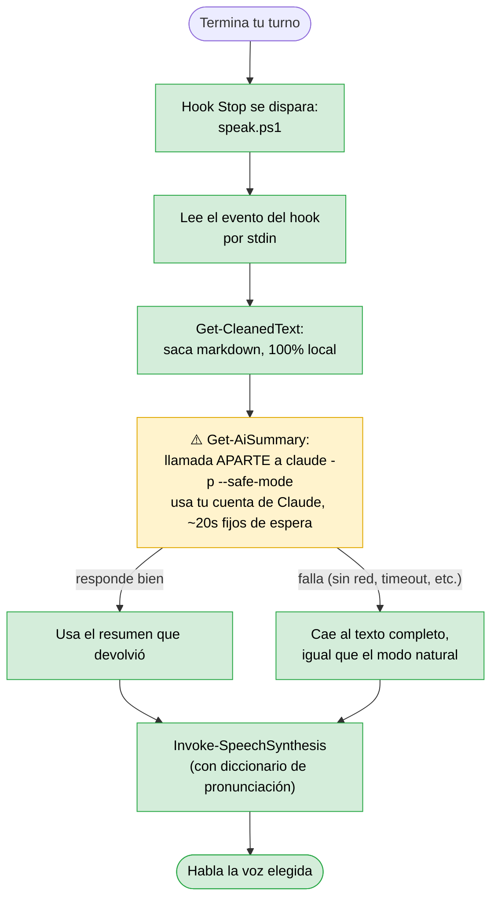
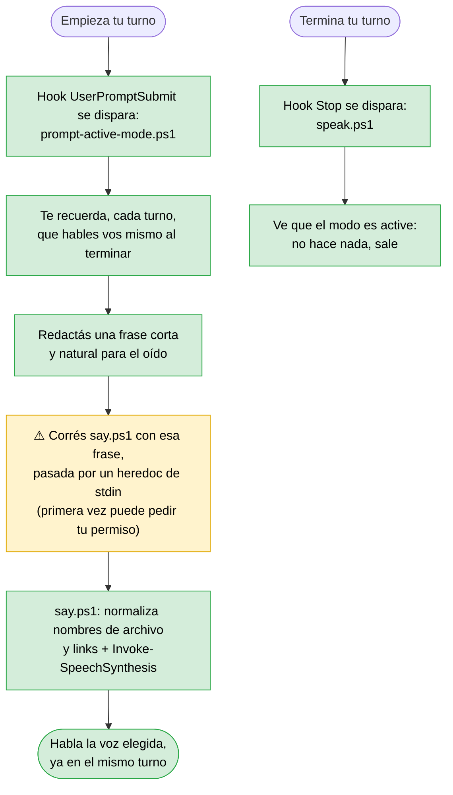
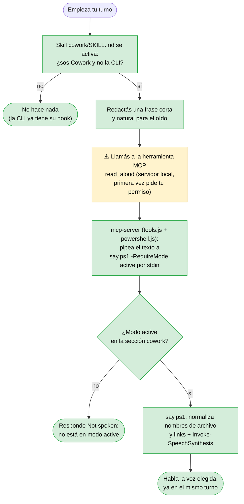

# Arquitectura de sapi-voice-kit

Detalle técnico de qué componente hace qué en cada uno de los cuatro modos de lectura — para instalación, comandos, y una descripción general, ver el [README](README.md).

## Estructura del código

Todos los scripts cargan `scripts/common.ps1`, que solo ordena la carga de `scripts/lib/`. Cada archivo de `lib/` tiene una responsabilidad:

| Archivo | Responsabilidad |
|---|---|
| `mutex.ps1` | Candado entre procesos con nombre (`Invoke-WithNamedMutex`), usado por la configuración y por el habla |
| `config.ps1` | Dónde vive la carpeta de datos y cómo se lee/escribe `config.json` (secciones `local` y `cowork`) |
| `speech-guard.ps1` | Evita hablar dos veces la misma respuesta (una marca de tiempo, nunca texto) |
| `logging.ps1` | Log de diagnóstico, solo con `debug on` |
| `script-context.ps1` | Lo que todo script necesita al arrancar: configuración, logger y lectura de stdin en UTF-8 |
| `text-normalization.ps1` | De texto escrito a texto para el oído: archivos, rutas, links, abreviaturas, markdown |
| `pronunciation.ps1` + `pronunciations/<idioma>.psd1` + `respellings/<idioma>.psd1` | Los diccionarios IPA (hoy solo `es.psd1`, para toda voz en español; otro idioma se agrega con su propio archivo), las reescrituras de palabras que la voz acentúa mal aun con IPA (p. ej. `natural` se lee `naturál`; la pantalla no cambia) y cómo se parte un texto en segmentos con y sin pronunciación |
| `speech-rate.ps1` | La velocidad de lectura (-10 a 10) y su saneamiento |
| `engine-onecore.ps1`, `engine-sapi5.ps1` | Los dos motores de voz; cada uno arma su propio formato de pronunciación (SSML `<phoneme>` en OneCore, `PromptBuilder` en SAPI5), sin lógica de elección |
| `voices.ps1` | Qué voz habla: lista unificada de voces y elección por nombre o idioma |
| `speech.ps1` | Hablar: toma el candado, usa el motor de la voz y cae a SAPI5 si falla |
| `spoken-text-prompt.ps1` | Texto que el modelo escribe solo para ser escuchado (modo `summary` y recordatorio del modo `active`) |

Los scripts de `scripts/` son los puntos de entrada: `speak.ps1` (hook `Stop`), `prompt-active-mode.ps1` (hook `UserPromptSubmit`), `say.ps1` (hablar texto recibido por stdin), `say-test.ps1`, `self-test.ps1` (la prueba completa con medidor de audio, `lib/audio-meter.ps1`), `list-voices.ps1` y los `set-*.ps1` de cada comando.

El servidor MCP de Cowork (`mcp-server/`) separa el protocolo (`protocol.js`), las herramientas (`tools.js`) y el lanzamiento de PowerShell (`powershell.js`); `server.js` solo los conecta. No lee la configuración: cada herramienta ejecuta un script, y el servidor le indica al script que es Cowork con la variable de entorno `SAPI_VOICE_NAMESPACE=cowork`.

## Qué corre en cada modo, componente por componente

Cada modo usa una combinación distinta de piezas. Los cuadros verdes son 100% locales e instantáneos; los amarillos son el único punto de cada modo que cuesta algo extra (uso de tu cuenta, tiempo de espera, o un permiso que aprobar).

### Modo `natural` (el que viene activado por defecto)

Todo local, todo instantáneo. Ningún componente sale de tu máquina.

### Modo `literal`

El modo más simple: cero procesamiento, cero componentes extra.

### Modo `summary`

El único de los cuatro que sale de tu máquina hacia una llamada de Claude — por eso no viene activado por defecto. Si esa llamada falla por lo que sea, nunca te quedás sin nada: cae al comportamiento del modo natural.

### Modo `active`

Un solo modo, la misma idea (el modelo dice una frase corta él mismo, en el momento) — pero con dos caminos distintos según dónde estés corriendo, porque **Claude Cowork/Desktop no dispara ningún hook de plugin** (confirmado contra varios issues abiertos del repo de Claude Code). En la CLI, un hook se lo recuerda al modelo cada turno; en Cowork, no hay hook equivalente, así que una skill cumple ese rol en su lugar.

**En la CLI:**

El hook `Stop` (abajo del diagrama) sigue disparándose igual que en los otros modos, pero se queda quieto a propósito — así nunca se superponen las dos formas de hablar.

**En Claude Cowork/Desktop:**

Mismo mecanismo que en la CLI (el modelo pipea una frase a `say.ps1`), pero a través de un servidor MCP local en vez de un heredoc de shell — porque acá no hay ningún hook que dispare nada (el `Stop` hook tampoco corre en Cowork, así que no hace falta que se quede quieto a propósito como en la CLI). La diferencia real con la CLI: ahí un hook le recuerda al modelo cada turno sin que dependa de su propio juicio; acá, nada fuerza que la skill se dispare — es una limitación real de Cowork, no algo que este plugin pueda resolver del todo.
